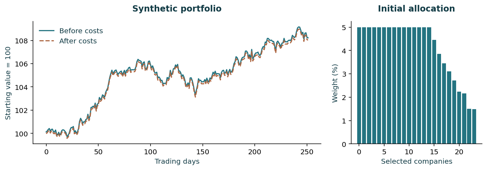

# TransitionLens

How much does an emissions advantage matter once it is scaled by enterprise value? This public edition of a sustainable equity research project follows one carbon-price assumption through stock selection, portfolio weights and trading costs.

## The experiment

The signal compares a company's combined Scope 1 and Scope 2 emissions intensity with its industry median. The model multiplies the difference by revenue and a hypothetical carbon price, then scales it by enterprise value. The result measures sensitivity to that assumption. Its interpretation depends on the assumed carbon price and the emissions covered.

The example ranks 80 fictional companies, selects the top 30 percent, caps positions and rebalances quarterly. The backtest tracks gross and net returns separately so the effect of turnover is visible.

At EUR 65 per tonne, 24 of the 80 companies entered the portfolio and the largest starting weight was 5 percent. Over the 252 simulated trading days, the portfolio gained 8.23 percent before costs and 8.03 percent after costs. These figures describe the synthetic demonstration.



## Run it

```sh
python -m pip install -r requirements.txt
python example.py
```

The random seed is fixed. Changing the carbon price, the selection threshold or the transaction cost in [the example](example.py) lets you repeat the experiment. The [research modules](a9) contain the original ranking, weighting and backtesting functions. The demonstration generates all its inputs locally.

Research portfolio by **Tom Bussard**, Université Paris Dauphine PSL, November 2026.
